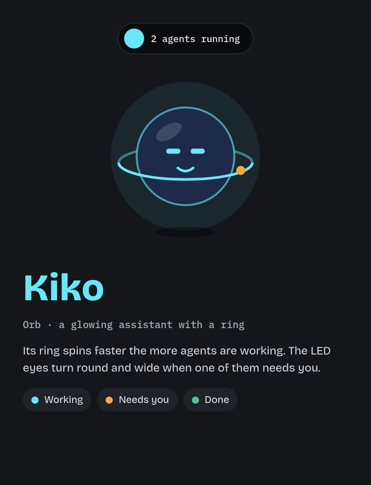

<p align="center">
  
</p>

<h1 align="center">Kiko 🪐</h1>

<p align="center"><b>A floating desktop companion for Claude Code.</b></p>

Kiko shows your Claude Code sessions in a small island at the top of the screen. You can follow what the agent is doing, approve its commands and answer its questions without going back to the terminal.

Built with **Tauri 2, Rust, React, TypeScript and Motion**. Linux first (Ubuntu with GNOME).

## ✨ Features

- **Live sessions:** every running Claude Code session with its project, current step, elapsed time and lines added / removed.
- **Permission requests:** Allow, Deny or Always from the island, or hand the request back to the terminal.
- **Questions:** answer Claude's multiple-choice questions directly from the island.
- **Chat:** write to a running session from the island and read Claude's replies there (Claude Code channels, research preview).
- **Kiko, the orb:** six moods with LED eyes. Its ring spins faster the more agents are working.
- **Three island states:** hidden, compact and expanded, with smooth animations and reduced-motion support.
- **Safe setup:** hooks are installed from the Settings window, with a preview of the exact change, a backup, and a clean uninstall.
- **Silent when closed:** if Kiko is not running, Claude Code works exactly as before.

## 🖥️ How It Works

```
Claude Code ── hooks ──▶ Kiko (local only)
                           │
                           ▼
                        island
                           │
Claude Code ◀── your decision: Allow / Deny / Always / answer
```

Kiko adds hooks to Claude Code. On each event (session start, prompt, tool use, permission request, stop...), Claude Code sends it to Kiko on your computer, and the island updates. When Claude needs your approval or an answer, Kiko waits for your choice and sends it back. If you don't answer, Claude Code shows its normal terminal prompt.

## 🎭 Moods

| Mood | When |
|---|---|
| Sleeping | No Claude Code session is open |
| Idle | A session is waiting for your next prompt |
| Working | A session is running |
| Needs You | A permission or a question is waiting for you |
| Done | A session just finished its task |
| Error | Something went wrong in the session |

## 🪟 Island

| State | Content |
|---|---|
| Hidden | A thin pill at the top edge, opens on hover |
| Compact | Mini Kiko, a one-line status ("Editing app.tsx", "2 agents running"), lines added / removed |
| Expanded | Kiko with its speech bubble, session list, last steps, permission or question card |

## 🚀 Getting Started

### Requirements

- Ubuntu (GNOME)
- Node.js 20 or newer
- Rust (stable)
- curl
- Claude Code

```bash
sudo apt update && sudo apt install -y build-essential curl wget file pkg-config libwebkit2gtk-4.1-dev libxdo-dev libssl-dev libayatana-appindicator3-dev librsvg2-dev
curl --proto '=https' --tlsv1.2 -sSf https://sh.rustup.rs | sh
```

### Install and run

```bash
git clone https://github.com/ElFarisssaid19/kiko-orb.git
cd kiko-orb
npm install
npm run tauri dev
```

The first build takes a few minutes.

### Connect Claude Code

1. Hover the thin pill at the top of the screen and click **Set up Claude Code hooks**. The Settings window opens.
2. Click **Install hooks…** and check the preview of the change.
3. Click **Write settings.json**. The status turns **Installed**.
4. Run `claude` in any project. The session appears in the island.

To remove them: **Settings → Remove hooks…**

### Chat with a session (optional)

Needs Claude Code 2.1.80 or newer, signed in with a claude.ai account.

1. **Settings → Chat → Install chat…**, check the preview, then **Install**.
2. Start Claude Code with the launch command shown there (or add the suggested `kiko-claude` alias to your shell):
   `claude --mcp-config ~/.config/kiko/mcp.json --dangerously-load-development-channels server:kiko`
3. Accept the development-channels warning. In the island, select the session and click **Chat**.

Sessions started with a plain `claude` never load Kiko's chat.

## 🔒 Privacy

- Kiko runs only on your computer and sends nothing outside it.
- Kiko changes your Claude Code settings only after you confirm the preview, and always makes a backup first.

## 🗺️ Roadmap

- [x] Kiko character and moods
- [x] Floating island with permission and question cards
- [x] Real Claude Code integration
- [x] Settings with safe hooks install and uninstall
- [x] Chat with a running session
- [ ] Global shortcuts and more settings
- [ ] Linux installer (`.deb` or AppImage)
- [ ] Windows and macOS

## 📄 License

No license has been chosen yet. Ask the authors before reusing the code.

---

<p align="center"><b>Kiko — stay in your flow while your agent works.</b></p>